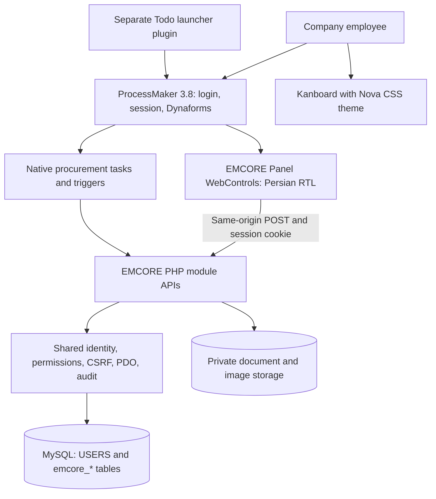
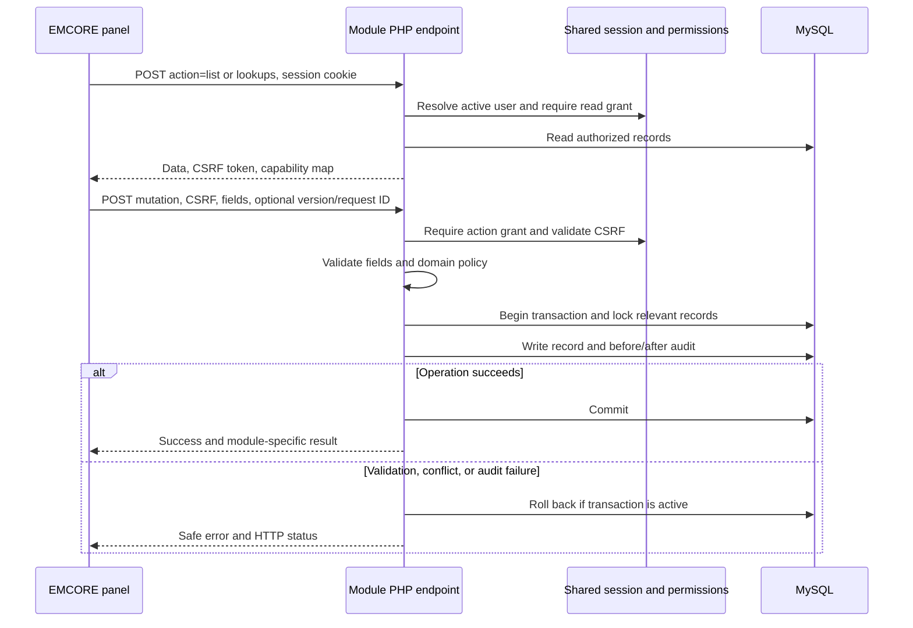
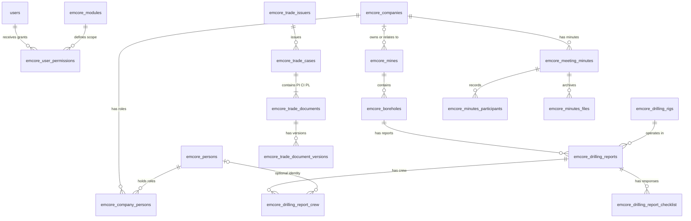
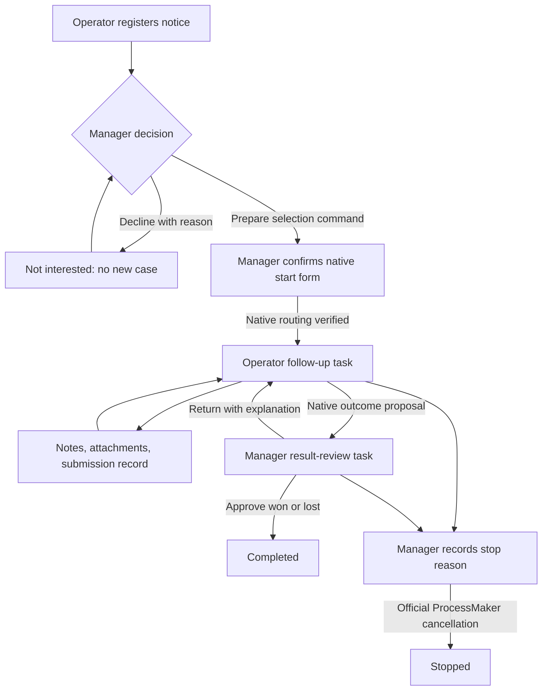

# EMCORE: architecture, data, and developer onboarding guide

_Comprehensive Mining BPMS and related company tools · Prepared 11 October 2026 · Audience: developers, technical colleagues, ProcessMaker administrators, and project maintainers_

---

**Purpose of this document:** explain what the project does, what data it manages, how its parts work together, why its design makes sense, and how a colleague can safely maintain or extend it. The main subject is `comprehensive-mining-bpms`; the Todo plugin and Kanboard theme are supporting projects. The two abandoned repositories appear only as historical context.

**Evidence boundary:** this guide was derived from the repositories' default-branch source, SQL migrations, tests, and existing documentation. It is a source review, not an inspection of the company's live server. “Implemented” means an implementation exists in the inspected snapshot. “Reported deployed” means repository documentation or the project owner reports deployment. These are distinct from production acceptance independently verified for this document. Architectural rationale marked **interpretation** explains the observed design; it does not claim to reproduce undocumented original decisions.

**Contents**

1. [Project purpose and repository landscape](#overview)
2. [Main idea and system architecture](#architecture)
3. [Data, sources, and model](#data)
4. [Features and domain workflows](#features)
5. [API, permissions, consistency, and files](#api)
6. [Technologies and package inventory](#dependencies)
7. [Setup, deployment, testing, and recovery](#operations)
8. [Developer workflow and extension rules](#development)
9. [Known boundaries, design debt, and next decisions](#boundaries)
10. [Source map, glossary, and reviewed snapshots](#sources)

<a id="overview"></a>

## 📋 1. Project purpose and repository landscape

### Business objective

EMCORE is an internal operational information system for the Emidco group and related mining companies. Its objective is to bring corporate reference data, mining operations, business documents, and selected administrative records into a consistent, searchable, permission-controlled environment that the company can maintain incrementally. ProcessMaker 3.8 provides the existing employee login and workflow environment; EMCORE adds structured records, purpose-built interfaces, validation, audit history, migration tools, and analytics.[^foundation]

The practical jobs include recording daily drilling, understanding borehole progress and crew work, maintaining company/person/mine records, registering visitors, tracking tenders and auctions, organizing export/import documents, archiving meeting minutes, and preserving business contacts. Some older corporate-domain specifications also describe memberships, credentials, internet services, and unified expiry alerts; those specifications should not be read as evidence that every screen or workflow has been delivered.[^foundation][^roadmap]

The source supports the following intended outcomes. No quantified savings, adoption rate, or production performance claim is made here:

| Objective | Mechanism in the implementation | Example of useful evidence |
|---|---|---|
| Make operational records consistently accessible | Shared database, module APIs, Persian interfaces | A borehole's reports can be retrieved by stable internal ID |
| Control who may change records | ProcessMaker session identity and independent module CRUD grants | A reporting user can read drilling data but cannot edit it |
| Make changes traceable | Transactional before/after audit records | An administrator can identify the actor and previous field values |
| Preserve historical business evidence | Source identifiers, snapshots, versioned files, soft deletion | An old trade-document number is retained even if it is inconsistent |
| Improve reporting reliability | Explicit metric definitions and shared filter scopes | Missing work hours are disclosed instead of counted as zero |
| Modernize without replacing the existing platform | Small PHP/API/panel modules beside ProcessMaker | A new archive can be added without rebuilding authentication |

### Which repository does what?

| Repository | Role and relationship | Treatment in this guide |
|---|---|---|
| [comprehensive-mining-bpms](https://github.com/soroushyasini/comprehensive-mining-bpms) | Current primary EMCORE application; main development focus according to the owner | Detailed architecture, data, modules, integration, and maintenance |
| [emcore-todo-processmaker](https://github.com/soroushyasini/emcore-todo-processmaker) | Separate ProcessMaker plugin for a personal Todo launcher in the EMCORE interface | Explain its host integration and current prototype boundary |
| [Kanboard-Nova](https://github.com/soroushyasini/Kanboard-Nova) | Kanboard visual theme; deployed on the company server according to the owner | Explain customization, technologies, and deployment |
| [Mining-ops-Data-Entry-Platform](https://github.com/soroushyasini/Mining-ops-Data-Entry-Platform) | Abandoned standalone mining supply-chain API experiment | Brief technical background only |
| [E_codeBase](https://github.com/soroushyasini/E_codeBase) | Abandoned collection of earlier ProcessMaker processes, reporting, and preprocessing; predecessor according to the owner | Brief explanation of evolution into EMCORE |

“Abandoned” is the owner's project-status description. It is separate from GitHub's archive flag. Repository proximity also does not imply an API integration: no EMCORE-to-Kanboard data synchronization is established by the reviewed code.[^todo][^nova]

### Read this guide by role

- **Business or technical colleague:** read sections 1, 2, 3, and 4 for objectives, architecture, data, and features.
- **Developer joining the project:** continue through sections 5, 6, 7, and 8 for contracts, packages, setup, and change rules.
- **ProcessMaker administrator or operator:** focus on sections 4.3, 5, and 7 for native routing, session compatibility, private files, deployment, and recovery.
- **Reviewer or future maintainer:** use section 9 for limitations and section 10 for the exact source snapshot and code-reading map.

<a id="architecture"></a>

## 🏗️ 2. Main idea and system architecture

### Architectural model

EMCORE is best described as a **modular application integrated into ProcessMaker**, with a hybrid of immediate operational CRUD and native routed workflow. This is an architectural interpretation of the source layout and execution paths. The inspected implementation does not establish a microservice deployment, a React application, or an independently authenticated API platform.[^foundation][^bootstrap]

An ordinary module consists of SQL tables, a PHP endpoint, a Persian RTL Panel WebControl, module permissions, audit behavior, and deployment/verification instructions. Newer modules extract domain and file-storage helpers as their rules become more substantial.



The Kanboard branch shows a separate employee tool. It does not represent an EMCORE API connection.

### Responsibilities and boundaries

| Layer | Owns | Does not automatically provide |
|---|---|---|
| ProcessMaker | Login, PHP session, canonical `USERS` identities, Dynaforms, tasks, native routing, triggers | EMCORE module CRUD grants or every business validation rule |
| EMCORE panel | Persian interaction, field entry, search/filtering, capability-aware controls, safe rendering | Trustworthy authorization merely by hiding buttons |
| EMCORE API and helpers | Active-user verification, module grants, CSRF, input validation, domain transitions, transactions, audit | A second employee-password store |
| MySQL/InnoDB | Structured records, constraints, keys, counters, transactional state | A complete filesystem transaction or automatic data-quality repair |
| Private filesystem | Original images, templates, scans, attachments, document versions | Public access by a web URL |
| CLI tools | Import, release checks, packaging, configuration, reconciliation | A replacement for native ProcessMaker acceptance testing |

ProcessMaker session identity is reused directly: `$_SESSION['USER_LOGGED']` resolves to an active `USERS.USR_UID`. EMCORE does not implement OAuth/OIDC in this path and does not recheck or copy ProcessMaker passwords. API and ProcessMaker must share compatible PHP session settings and a browser origin.[^bootstrap]

### CRUD versus routed work

Use the ad-hoc API/panel pattern for work that should take effect immediately: add a company, register a visit, update a drilling report, or archive a scan. A ProcessMaker case is not required for each of those edits.

Use native ProcessMaker tasks when the business action needs an explicit human handoff, assignment, decision, or routed lifecycle. Procurement demonstrates this split: the operational register is maintained through EMCORE, while selection, follow-up, and result review can be coordinated through native tasks and triggers. The workflow feature is disabled by default until installation-specific users, process IDs, and task IDs are configured.[^workflow]

### Request and transaction lifecycle



Read-only initialization requires a read grant. Capabilities are independent; a create grant alone does not automatically provide the lookup access a panel needs. Provision practical operator combinations deliberately.[^foundation]

### Why this design was chosen: interpretation and trade-offs

| Observed choice | Practical rationale inferred from the code | Consequence for maintainers |
|---|---|---|
| Reuse ProcessMaker identity and interface | Fit the company's existing employee environment and avoid another login system | Session compatibility becomes a deployment requirement |
| Use small PHP endpoints and panels | Deliver modules incrementally with the installed PHP/jQuery stack | Conventions must be maintained across multiple endpoint files |
| Keep simple CRUD outside case routing | Avoid creating a workflow case for every immediate record edit | Route only actions that actually require a handoff |
| Use relational parent/child tables | Represent reports, crews, documents, and versions explicitly | Schema changes and deletion rules require coordinated migrations |
| Preserve snapshots and source lineage | Keep historical evidence understandable after reference data changes | Some duplication is intentional and should not be “normalized away” |
| Use local browser libraries | Work inside the existing origin without a runtime CDN dependency | Installation asset versions and paths must be checked |
| Use optimistic versions and request IDs in newer modules | Prevent stale saves and duplicate retries | These features are not uniform across all older endpoints |
| Use private files plus guarded downloads | Apply the same authorization boundary to documents as to records | Backup and restore must include both database and files |

These are explanations of the implementation's fit and costs, not claims that documented comparisons of all alternative architectures were made.[^foundation][^minutes][^cards]

<a id="data"></a>

## 💾 3. Data, sources, and model

### What is the data?

The application handles **operational business records**, rather than a machine-learning training dataset or a sensor-stream platform. A datum usually describes an identifiable company, person, mine, visit, shift report, procurement opportunity, business document, meeting, or contact. Files are linked evidence; analytics are derived views over those records.[^foundation]

| Data domain | Representative fields or content | Source and significance |
|---|---|---|
| Companies | Persian/legal name, legal type, registration and national identifiers, phone, active state | Reference entities for the mining group and company-linked records |
| Persons and company roles | Names, identity/contact/education fields; role type, title, dates, current relationship | Operational personnel and corporate-role context; distinct from ProcessMaker login accounts |
| Mines and technical managers | Owner/relationship, location/resource/license details, validity dates, manager appointments | Distinguish owned, contractor, and personnel-related mines |
| Drilling | Borehole, rig, date/shift, start/end depth, reported drilling, equipment hours, consumables, stops, crew, checklist | New operator entry plus historical daily-report import |
| Visitor ledger | Visitor/organization, host snapshot or user link, visit purpose, entry/exit times | One record per physical visit |
| Trade documents | Issuer, case, PI/CI/PL numbers, states, versions, Word templates, supporting files | Controlled register for export/import documentation |
| Tenders and auctions | Type, source, title, authority, classification, quantity/amount text, deadlines, status, files | New register plus legacy database backfill |
| Meeting minutes | Company, assigned/historical number, date/time, agenda, participants, roles, scans, attachments | Corporate meeting archive with historical snapshots |
| Business cards | Contact/organization, multiple communication points and locations, countries, optional coordinates, one current image | Shared archive plus a reviewed source-import pipeline |
| Platform accountability | Module grants, actor IDs, request IDs, before/after snapshots, download history | Security administration and traceability |

Examples are a field inventory, not a disclosure of employee records. Ignored source exports and operational attachments should remain outside the distributable developer guide.[^foundation][^drilling][^trade][^notices][^minutes][^cards]

### Core relationships

This is a selected conceptual ER view, not a replacement for migration DDL. “Logged identity” is a logical relationship; not every identity reference is enforced with a foreign key to ProcessMaker's `USERS` table.



Two boundaries are especially useful: a ProcessMaker account identifies a logged-in actor, while an `emcore_persons` row represents a business person; an external business-card contact is deliberately independent of both internal company and personnel records. Do not assume these are interchangeable identities.[^bootstrap][^cards]

### Data conventions

| Convention | Meaning and maintenance rule |
|---|---|
| `emcore_` tables and English `snake_case` fields | Keep database and API contracts stable; translate labels in the interface |
| InnoDB with `utf8mb4` | Support transactions, relationships, and Persian/English text |
| Integer entity IDs | Join records by stable IDs, not human names or document-number similarity |
| `USR_UID` | ProcessMaker account identity; normally a 32-character platform identifier |
| `deleted_at` | Business soft deletion; active queries must deliberately exclude retired rows |
| `is_active` | Availability/state of a record; distinguish it from soft deletion |
| `DECIMAL` fields | Preserve appropriate numeric precision for quantities and hours |
| Name/company snapshots | Preserve the historical name at the time of an event |
| `legacy_id`, source keys, source JSON | Record provenance and allow reconciliation without guessing |
| `lock_version` where implemented | Reject stale edits/deletes with HTTP 409 |
| `request_id` where implemented | Identify a retryable operation independently of the record ID |

Not every legacy amount is normalized into a numeric monetary field. Procurement retains legacy amount/quantity text and separately handles newer estimated amounts. Business meaning and currency must be established before aggregating them.[^foundation][^notices]

### Calendars, times, and unknown values

Most operator-facing dates use Jalali `YYYY/MM/DD`. Relevant `_en` columns contain Gregorian dates for comparisons, sorting, and deadline calculations. Several established modules use the MySQL function `shamsi_slash_to_gregorian_date()`; meeting minutes instead use validated PHP calendar conversion and obtain today's date in `Asia/Tehran`. Do not impose one conversion dependency on all modules.[^dates][^minutes]

Time behavior also varies: visitor checkout uses database `NOW()`, visitor defaults use browser-local entry values, meeting minutes use explicit time fields and an overnight flag, and trade numbering takes the database's Gregorian year. Align browser, PHP, database, and scheduler configuration during deployment; this guide does not assert that every module uses UTC internally.[^visitors][^trade][^minutes]

An unknown value must retain its meaning. `worked_hours = NULL` is unknown work time; it is neither zero nor an assumed 12-hour shift. An unknown legacy procurement status remains explicit. A missing historical meeting date stays null. Uncertain country or contact details are not fabricated.[^drillanalytics][^notices][^minutes][^cards]

### Historical sources and loss-preserving import

| Import area | Authoritative source described by the repository | Preservation behavior |
|---|---|---|
| Drilling masters | Legacy project and borehole data; documented 6 project mappings and 170 supplied boreholes | Reviewed mine mapping, aliases, separate movable rigs |
| Daily drilling | `prc_db_gozaresh_ruzane_copy2`; documented 2,035 source rows | Source IDs and raw rows retained; mapped rows become reports; incomplete rows remain `needs_review` |
| Procurement notices | Allowlisted table `prc_db_mozayedat_monaghesat_copy1` | Idempotent legacy source ID, original row snapshot, file references, import-batch statistics |
| Business cards | Two private Markdown sources and associated original images | Documented 443 entries, 304 images, 139 entries without images; all begin needing review |
| Historical trade and minutes | Explicit legacy-entry paths | Keep original numbers and missing information without pretending they were new system-issued records |

These figures are documented migration/fixture baselines, not live record counts measured during this review. Business-card sources are ignored/private, so their contents and original files were not independently reconstructed here.[^drilling][^notices][^cards]

```mermaid
flowchart LR
    accTitle: Drilling legacy import preservation flow
    accDescr: The drilling importer previews historical rows, preserves parseable source identifiers in staging, imports adequately mapped rows into canonical records, and retains incomplete rows for human review.
    source_rows["Authoritative legacy MySQL rows"] --> dry_run["Dry run and reconciliation"]
    dry_run --> committed_import["Explicit commit with permitted actor"]
    committed_import --> staging["Preserved source rows and IDs"]
    staging --> mapped{ "Required mapping complete?" }
    mapped -->|"Yes"| canonical["Canonical report, crew, checklist, audit"]
    mapped -->|"No"| needs_review["needs_review: retain unresolved source"]
    needs_review --> reviewed_mapping["Human-reviewed mapping correction"]
    reviewed_mapping --> mapped
```

The diagram describes drilling specifically. Procurement and card imports have their own schemas and validation paths; they should not be assumed to share the same staging table.

Drilling intentionally allows multiple reports for one borehole/date/shift. Their contextual combination is indexed but not unique, because distinct historical reports share it. Source IDs provide import identity. Likewise, a repeated name or image hash in the contact archive is a review signal, not permission to merge or delete records automatically.[^drillmigration][^cards]

<a id="features"></a>

## ⚙️ 4. Features and domain workflows

### Implementation and delivery status

The table combines executable source existence with the latest relevant repository notes. Some general documents have older “last reviewed” dates than later module additions; prefer module-specific code and notes when they disagree.[^foundation][^roadmap]

| Area | Implemented behavior | Delivery boundary in reviewed evidence |
|---|---|---|
| Authentication and authorization | Active ProcessMaker session, per-user/module C/R/U/D, protected administration | Foundation reported deployed and tested on 9 August 2026 |
| Audit | Before/after change records and read API | Implemented; dedicated audit UI remains pending |
| Companies and persons | Protected basic CRUD; person role context | Implemented; historical multi-tab specifications exceed current CRUD scope |
| Mines and technical managers | Mine relationships, validity information, manager records, merge lineage support | Implemented; verify exact deployment in target installation |
| Daily drilling | Reports, crew, checklist, stops, actual hours, protected API/panels | Production migration/API import reported verified; panel acceptance still noted as pending |
| Drilling analytics | Borehole progress, crew/attendance views, explicit quality indicators, Excel export | Implemented; live reporting acceptance remains installation-specific |
| Visitor ledger | Arrival, correction, one-time checkout, filters, current-presence ordering | Implemented; deployment noted as pending |
| Trade documents | Issuer counters, PI/CI/PL lifecycle, versions, templates, private files, historical records | Implemented; production rollout and acceptance noted as pending |
| Tender/auction register and analytics | Deadlines, classification, files, optimistic edits, filtered reporting, backfill tool | Implemented; legacy dry run and rollout noted as pending |
| Procurement routed workflow | Two roles, native tasks, guarded commands, events, notifications, reconciliation | Implementation provided; disabled by default and requires native process installation |
| Meeting minutes | Company/year numbering, participants, scan history, retry/concurrency controls | Isolated verification documented; native deployment/session acceptance pending |
| Business cards | Shared contacts, countries/locations, current original image, import/review, preview | Isolated seed/API/browser verification documented; native deployment pending |
| Company-person CRUD, memberships, credential/token, internet-service, general attachment, unified expiry modules | Domain design or future scope | Do not label as completed modules merely because specifications exist |

### Core records and daily drilling

Companies and persons provide common reference data. The current company endpoint handles core identity/contact fields; the person endpoint includes personnel fields and reads company-role context. A future specification for board, credential, membership, and document tabs is broader than the implemented company CRUD endpoint.[^companycode][^personcode]

Mines carry a relationship type: `owned`, `contractor`, or `personnel_related`. A borehole belongs to one mine; a rig is an independent asset that can move. Duplicate mine history can be retained using aliases and `merged_into_id`; the mine API guards deletion when manager, borehole, or merge-lineage dependencies exist. There is no general merge action in the inspected mine endpoint's allowlist, so do not assume the panel offers arbitrary mine merging.[^minescode][^minemigration]

Each drilling report links a borehole and rig to a date and shift. It includes depth, drilling amount, equipment time, water/fuel/other consumables, operational descriptions, incoming/outgoing equipment, crew, and a stable 14-item checklist. Crew entries can reference a registered person or retain a temporary worker name. Roles belong to an assignment within a report; they are not separate person identities.[^drilling][^drillmigration]

| Drilling state | Rule for newly entered data |
|---|---|
| `drilling` | No reported stop; stop cause/duration are cleared |
| `partially_stopped` | Cause required; positive stop duration up to 12 hours |
| `no_drilling` | Cause required; start and end depths equal; stop duration is null |

The old `stop_time = 99` marker maps to `no_drilling`; it is not treated as 99 hours. New records derive drilling amount from start/end depth, while historical inconsistencies are preserved and disclosed. Legacy crew names are not automatically matched to personnel because spelling similarity does not establish identity.[^drilling]

Drilling analytics must be interpreted carefully:

- **Reported drilling** is the sum of stored `drill_amount`; **latest physical end depth** is the latest report's end-depth value. These are different quantities.
- The borehole overview uses the full non-deleted history of the selected mine/borehole. Attendance has its own site/month filters.
- A day without a report is missing observation, not automatically zero production.
- Actual crew hours and equipment hours are different denominators. Consumption per metre is undefined when total drilling is zero.
- “Drilling in shifts attended by a worker” is contextual production, not that worker's personal output or allocation of production credit.
- Unknown hours, duplicate assignments, implausible accumulated hours, invalid shifts, and old negative quantities are quality disclosures rather than silently corrected values.[^drillanalytics]

### Procurement: register, analytics, and native workflow

The tender/auction register tracks the opportunity, source, contracting authority, classification, participation state, response/document deadlines, responsible unit, and files. Remaining time is computed from current dates; imported `LEFT_DAYS` values are not reused as live truth. Classification has category, subcategory, and product reference tables. The Excel export uses the last successful list query and retrieves all matching pages, preserving its filter/sort scope.[^notices]

The separate read-only analytics endpoint uses canonical, non-deleted EMCORE rows. It reports type, responsible units, categories, participation, deadline health, monthly trends, authority groups, and classification drill-down. Unknown types/statuses and missing or inconsistent dates remain visible. File coverage means a file or retained reference exists; it does not guarantee an old reference can be downloaded.[^procanalytics]

The optional routed workflow adds a configured **operator** and **manager**. Its policy narrows record/file/report access to those participants; broad CRUD grants alone do not grant managerial decisions. An operator registers an opportunity, and the manager may decline interest without creating a case. Selection for follow-up prepares a command, then the manager confirms and routes through the native start form. The business state is finalized only after successful native routing.[^workflow][^workflowpolicy]



Key integration details explain why this feature is more than status dropdowns:

1. `Before Assignment` validates the command before ProcessMaker chooses the next actor. Moving this validation to an asynchronous job changes its safety boundary.
2. Value Based assignment reads verified operator/manager variables. The code does not make an extra `PMFDerivateCase()` routing call.
3. `After Routing` reconciles actual platform state. A scheduled CLI reconciliation pass repairs valid pending synchronization and reports mismatches without guessing new assignments.
4. Native cancellation requires a valid recorded reason; completed/stopped cases are not reopened by this version.
5. Events and notifications persist in the database. A displayed event can be marked seen after its header is visible for at least one second in an active tab; that is a UI-view record, not proof of reading or approval.
6. Native process definitions are implementation instructions/templates, not an import-ready `.pmx` backup. Real process, task, and user IDs must be verified on the target installation.[^workflow][^beforeassignment][^afterrouting]

Email, SMS, Bale messaging, multiple managers, reassignment, and reopening are outside this workflow version. Attachment behavior is action-specific: ordinary register uploads are queued independent requests, while a workflow publication groups its action files under its own validation/cleanup rules.[^workflow]

### Trade documents, meetings, visitors, and contacts

**Trade documents.** New export/import cases begin with a Proforma Invoice (**PI**) and have one PI, Commercial Invoice (**CI**), and Packing List (**PL**) record each. Issuer-specific counters reserve numbers under a database lock. CI and PL numbers derive from the PI number; they do not have independent counters. CI follows approved/issued PI, PL follows approved/issued CI, and completing a case requires all three documents to be approved/issued.[^trade]

Every upload creates a new document version. Six Word-template slots cover two issuers and three document types. Users complete files manually and record review outcomes; automatic Word generation, electronic signature validation, WhatsApp integration, and native trade-approval routing are outside this version. Historical entries retain original document numbers, do not advance the counter, and reserve conflicting numbers against future issuance. A soft-deleted/cancelled number is not recycled.[^trade]

**Meeting minutes.** New records receive `CODE/YYYY/NNNN` numbers with a counter per company and meeting year. Number preview is provisional; successful creation allocates the number with the record, participants, and audit in one transaction. Legacy records preserve their original number. A company code/number is not silently changed after issuance.[^minutes]

Participants may be active ProcessMaker users or external attendees; historical names and organizations remain snapshots. Presence, chair, and secretary are explicit. `awaiting_scan` versus `archived` reflects whether an active scan exists; metadata completeness is a separate property. Replacing a scan retains previous versions, while deleting the last active scan returns the record to awaiting scan. An archived scan is not evidence that its signatures were authenticated.[^minutes]

**Visitor ledger.** One row means one physical visit, not a visitor master or approval process. Presence is derived from `exited_at`: null means inside. Host identity may link to an active ProcessMaker user or use a manual name snapshot. Checkout records database time once, under update permission with audit. The panel puts visitors still inside first. Appointments, badges, vehicle access, photos, and physical-access decisions are outside scope.[^visitors]

**Business cards.** Each source entry remains an independent contact archive record, with repeated communication points and locations. Commercial country and address country are distinct. Optional WGS 84 coordinates are stored with provenance/precision, but a map, geocoding, OCR, QR decoding, and automatic merging are not implemented in v1.[^cards]

Each card has zero or one current original image, enforced with a generated key and uniqueness constraint. The table does not fetch images eagerly; an authorized popup retrieves the original on demand. No thumbnail is generated in the current version. Replacement keeps old files for accountability without exposing the previous image through the normal public module API. Contact similarity is advisory, not an automatic deduplication rule.[^cards][^cardmigration]

<a id="api"></a>

## 🔐 5. API, permissions, consistency, and files

### Transport and endpoint map

The main API uses **POST-based RPC actions**, rather than a REST resource router. A typical read is `POST /emcore_api/emcore_companies_api.php` with form field `action=list`. Reads commonly use form-encoded POST; file operations use multipart POST. The business fields are not universally read from an arbitrary raw JSON request body. Nested participant/contact/location arrays have their module-specific JSON-field contracts.[^bootstrap][^foundation]

The table maps permission scopes to actual endpoint basenames. Every endpoint is served under `/emcore_api/`; panel filenames below are relative to `panels/`, except the root authorization panel.

| Permission scope | Endpoint basename | Main panel or consumer |
|---|---|---|
| `authorization` | `emcore_authorization_api.php` | Root `emcore_authorization_panel.html` |
| `audit_log` | `emcore_audit_log_api.php` | Read API; dedicated panel pending |
| `companies` | `emcore_companies_api.php` | `emcore_companies_panel.html` |
| `persons` | `emcore_persons_api.php` | `emcore_persons_panel.html` |
| `mines` | `emcore_mines.php` | `emcore_mines_panel.html` |
| `mine_technical_managers` | `emcore_mine_technical_managers.php` | `emcore_mine_technical_managers_panel.html` |
| `drilling_daily_reports` | `emcore_drilling_reports.php`, `emcore_drilling_analytics.php` | Daily-report and analytics panels |
| `visitor_log` | `emcore_visitor_log.php` | `emcore_visitor_log_panel.html` |
| `trade_documents` | `emcore_trade_documents.php` | `emcore_trade_documents_panel.html` |
| `procurement_notices` | `emcore_procurement_notices.php`, `emcore_procurement_analytics.php` | Register, analytics, and native-workflow panels |
| `meeting_minutes` | `emcore_meeting_minutes.php` | `emcore_meeting_minutes_panel.html` |
| `business_cards` | `emcore_business_cards.php` | `emcore_business_cards_panel.html` |

Procurement's workflow helpers and installed triggers add policy to the register endpoint; there is no separate generic workflow REST service in this design.[^panels][^workflow]

A minimal authenticated read, from the application's browser context, looks like:

```javascript
jQuery.ajax({
  url: '/emcore_api/emcore_companies_api.php',
  method: 'POST',
  dataType: 'json',
  data: { action: 'list' }
}).done(function (response) {
  // Render response.data safely; retain response.csrf_token and permissions.
});
```

A company create request uses `action=create`, required `name_fa`, and optional fields such as `legal_type`, `reg_number`, `national_id`, and `phone`. Its actual success response puts `id` at the top level. This small inconsistency matters: the broadly documented `success/data` envelope is a convention, not a guarantee that every existing create action has the same payload shape.[^companycode]

Typical read envelope:

```json
{
  "success": true,
  "data": [],
  "csrf_token": "session-specific-token",
  "permissions": {
    "can_create": 1,
    "can_read": 1,
    "can_update": 0,
    "can_delete": 0
  }
}
```

Standard error envelope:

```json
{
  "success": false,
  "error": "Safe user-facing message",
  "details": { "field_name": "machine_readable_reason" }
}
```

`details` is optional. Successful file actions can return a binary stream, not a JSON body. Check the module's endpoint before writing a client.[^bootstrap][^minutes][^cards]

| HTTP status | Meaning in the shared/module contracts |
|---|---|
| `200` | Successful read/update/delete or recognized replay |
| `201` | First successful create/upload where the module uses it |
| `400` | Invalid action or malformed request |
| `401` | Missing valid session or inactive/unresolved actor |
| `403` | Insufficient grant or failed CSRF validation |
| `404` | Active target not found |
| `405` | Unsupported HTTP method |
| `409` | Stale version, retry-payload conflict, or incompatible business state |
| `422` | Field/domain validation failure |
| `500` | Unexpected server error; diagnostics belong in server logs |

### Authorization and audit

Authentication answers “which active ProcessMaker account is making this request?” Authorization separately checks `(usr_uid, module_key)` for `can_create`, `can_read`, `can_update`, or `can_delete`. Missing grants deny access. User names and role labels submitted by a browser are not identity evidence. Administration protects the final active authorization administrator from removal.[^bootstrap][^authorization]

Mutations require the session-bound CSRF token through `X-CSRF-Token` or a supported form field. A valid CSRF token does not replace a permission check. Panel controls should stay disabled/hidden until capabilities arrive, and all stored text should be inserted through safe DOM/text methods.[^bootstrap][^foundation]

The shared audit writer records request, actor, module, action, entity, before/after JSON, metadata, IP, user agent, and timestamp. Business updates and audit inserts belong in one database transaction, so an audit failure cannot leave a successful unaudited business edit. Download logging is module-specific; audit logging is not a record of every possible page view or failed login.[^audit]

“Append-only audit” describes the application's intended write pattern. The reviewed code is not proof of cryptographic tamper evidence or immunity to privileged database modification. Database grants, retention, and backup controls still matter.[^audit]

### Concurrency and retry semantics

Several newer modules combine row locks, optimistic versions, and idempotency. These mechanisms solve different problems:

| Mechanism | Prevents or detects | How to use it |
|---|---|---|
| Transaction and `SELECT ... FOR UPDATE` | Interleaved critical changes such as counter allocation | Keep counter, dependent records, and audit within the intended transaction |
| `lock_version` | An editor overwriting a newer saved version | Send the version originally read; reload and review on 409 |
| Stable operation `request_id` | Duplicate create/upload after a lost response | Retry with the same ID and identical operation payload |
| Source ID/key uniqueness | Importing a source record twice | Preserve source identity and review changed content rather than overwriting blindly |

For meeting minutes, a recognized replay is checked before the stale-version test, allowing a lost successful response to be recovered. Reusing one request ID for different content produces 409. Upload queues use a separate ID per file and retain successful earlier files; a later queue failure is not a rollback of the entire queue.[^minutes][^uicomponents]

Do not add automatic retries to older mutation endpoints without confirming server-side replay protection. The company/person APIs have transactions and locking but do not expose the newer universal `lock_version`/`request_id` pattern.[^companycode][^personcode]

### Private storage and download behavior

Files belong outside the web root. The database stores attachment/version metadata, including original names, generated storage names, sizes, MIME information, hashes, relationships, and lifecycle state. Authorized endpoints validate access and stream files; clients do not receive raw storage paths.[^trade][^minutes][^cards]

| Area | Default per-file limit | Important behavior |
|---|---|---|
| Trade documents | 50 MiB | Word templates; Word/PDF primary documents; broader supporting attachments |
| Procurement register | 50 MiB | Notice versus final-submission roles; legacy references distinguished from private uploaded files |
| Meeting minutes | 50 MiB | PDF/JPEG/PNG scans; broader attachment types; preserved replacement history |
| Business cards | 10 MiB | JPEG/PNG original; maximum 40 million pixels; one current image |

Limits are configurable and request-level PHP/web-server limits may reject an upload before application validation. The workflow publication path additionally limits an action's combined files and count. File type/content checks and SHA-256 integrity checks are not antivirus scanning or digital-signature validation.[^config][^workflow][^minutes][^cards]

Database and filesystem operations do not share a single ACID transaction. The implementations use cleanup for newly created files when operations fail, while successful historical files may be retained by policy. Recovery must reconcile database references and physical files together.[^minutesstorage][^cardstorage]

<a id="dependencies"></a>

## 📦 6. Technologies and package inventory

### Main application runtime and browser dependencies

The inspected main repository has no Composer manifest, npm package manifest, or lockfile establishing a complete installed dependency graph. Much of its runtime comes from the existing ProcessMaker server. The inventory below distinguishes platform requirements, host-supplied assets, and tooling rather than suggesting `npm install` builds the entire system.[^foundation][^fixtureminutes][^fixturecards]

| Technology/package | Version evidence | Purpose and delivery model |
|---|---|---|
| ProcessMaker | Target: 3.8 | Employee identity/session, Dynaforms/Panel WebControls, routed tasks and triggers; external platform |
| PHP | Some module notes target 8.1; isolated minutes/cards fixtures use 8.2 | Module APIs, domain logic, import/reconciliation commands; target compatibility must be tested |
| MySQL / InnoDB | MySQL 8.4 in documented minutes/cards fixtures; no single repository-wide production minimum established | Relational storage, constraints, counters, transactional writes and audit |
| PDO and `pdo_mysql` | PHP extensions, not Composer packages | Prepared SQL, transactions, shared connection |
| `mbstring` | Required by Unicode string-validation paths; installed in fixtures | Persian/Unicode lengths and string handling |
| Fileinfo / `finfo` | Used by storage validation | Inspect uploaded file MIME/content type |
| GD | Required by business-card image validation | Decode/validate image content and guard dimensions/memory; current version does not generate thumbnails |
| ZIP / `ZipArchive` | Included in minutes fixture | Inspect ZIP/Office container structure where required |
| jQuery | Provided by ProcessMaker; 1.11.3 used in documented isolated UI tests | AJAX, panel event handling, existing UI compatibility |
| Chart.js | Local host asset at `/lib/js/chart-js/chart.umd.min.js`; exact version not pinned here | Procurement analytics charts; supplied by the target installation |
| SheetJS/XLSX-compatible library | Local `/lib/xlsx.full.min_2.js`; exact version not established | Genuine Excel export for drilling attendance and procurement lists; compatibility paths accommodate older APIs |
| Native SVG | Browser feature | Self-contained drilling analytics/progression visuals |
| HTML, CSS, JavaScript | Source files; no mandatory bundler demonstrated | Persian RTL panels, responsive layouts, filters, modal interaction |
| Vazirmatn | Bundled TTF files with OFL license | Local Persian typography for shared EMCORE UI |
| `EmcoreUI` | Internal shared JavaScript/CSS, not an external package | Jalali datepicker, participant picker, modal/focus handling, upload queue, safe helper functions |

The reusable UI is visibly consumed by the newer minutes and business-card modules. A migration guide describes gradually adopting it elsewhere; it should not be described as an already completed rewrite of all panels.[^uicomponents][^cards][^fonts]

Version numbers above are **observed target/test evidence**, not a promise that upgrading a production ProcessMaker installation to a particular PHP/MySQL version is supported. Establish the actual server matrix before changing runtimes.

### Development, verification, migration, and packaging tools

| Tool/package | Purpose | Scope |
|---|---|---|
| Node.js standard libraries (`fs`, `path`, `assert`, `vm`, `crypto`, child processes) | Static release checks, JavaScript syntax/wiring assertions, API test clients | Developer/verification tooling |
| Playwright | Chromium browser interaction, accessibility-oriented behavior, concurrency/UI scenario tests | Test-only; scripts use an installed module or `EMCORE_TEST_NODE_MODULES` |
| Python standard library | Parse source Markdown/CSV, build JSON manifests, hashes, SQL packages, portable archives | Offline business-card preparation |
| Pillow (`PIL.Image`) | Inspect original images while preparing the portable card package | Python packaging dependency; not a main web runtime dependency |
| PowerShell | Deployment helpers, isolated test fixtures, synchronized file installation | Windows-oriented operational tooling |
| Docker | Disposable PHP/MySQL fixture infrastructure for selected modules | Verification environment; not proof that main production is containerized |
| Windows Task Scheduler | Periodic procurement reconciliation recommended by its runbook | Production integration when the workflow is enabled |
| MySQL `shamsi_slash_to_gregorian_date()` | Server-side Jalali conversion for several existing endpoints | Installation-specific stored routine, not an npm/PHP package |

Pillow, Playwright, Chart.js, and the XLSX build are not assigned invented version pins in this guide. The inspected files do not provide a complete lockable inventory for them.[^packager][^browsertest][^dates][^workflow]

### Supporting projects

**Todo plugin, version 0.1.1.** Uses ProcessMaker's PHP `PMPlugin`/registry and HeadPublisher APIs, plus plain browser JavaScript/CSS. A small marked loader bridges the company's custom interface because that renderer does not consume the standard shared HeadPublisher queue. The widget mounts only in the outer page and guards against duplicate loading/iframes. PowerShell deployment backs up the previous plugin/interface file and records recoverable state; rollback restores that captured state.[^todo][^todocode]

The current repository proves global launcher placement and panel interaction. It creates no task table, calls no task API, and stores no tasks. Its link to EMCORE is host-interface integration; a persistent personal task application remains future work in this snapshot.

**Kanboard Nova, version 0.1.2.** A small PHP plugin registers one stylesheet through `template:layout:css`. The visual layer uses CSS variables, logical properties for RTL, responsive layouts, focus/reduced-motion/contrast behavior, and modern selectors including `:has()`. It adds no JavaScript framework, schema migration, template rewrite, or build step. Install under the exact `plugins/Nova` directory/namespace and verify against the company's actual Kanboard 1.2.x UI and other plugins.[^nova][^novacode]

Its operational value is improving task-board readability and Persian usability. The owner's server deployment is acknowledged; a live visual/accessibility acceptance pass was not performed for this document.

### Abandoned work: brief technical background

**Mining-ops-Data-Entry-Platform** explores a separate gold-mining supply-chain API covering drivers, vehicles, truck loads, bunkers, lab batches/results, grinding, payments, and attachments. It organizes modules into router, schema, service, and model files, uses an async database layer, has Alembic migrations, pytest tests, and Docker/Compose/backup artifacts. This demonstrates familiarity with a standalone typed API stack; it is not the deployed EMCORE runtime and the owner describes it as abandoned.[^prototypecode]

Its pinned `requirements.txt` records the following packages:[^prototypedeps]

| Package/version | Purpose in that prototype's stack |
|---|---|
| `fastapi==0.115.6`, `uvicorn[standard]==0.34.0` | API framework and ASGI server |
| `sqlalchemy[asyncio]==2.0.36`, `asyncpg==0.30.0`, `greenlet==3.1.1` | ORM, asynchronous PostgreSQL access, SQLAlchemy execution support |
| `alembic==1.14.0`, `psycopg2-binary==2.9.10` | Schema migrations and synchronous PostgreSQL driver support |
| `pydantic-settings==2.7.0` | Typed environment/application configuration |
| `jdatetime==5.0.0` | Jalali date handling |
| `python-multipart==0.0.20`, `aiofiles==24.1.0` | Multipart upload and asynchronous file handling |
| `httpx==0.28.1`, `pytest==8.3.4`, `pytest-asyncio==0.24.0`, `aiosqlite==0.20.0` | HTTP/API tests, async tests, and SQLite-backed test support |

These are declared dependencies; listing them does not imply every package is a direct import in every module or that their present-day security/upgrade suitability was evaluated.

**E_codeBase** is the earlier ProcessMaker implementation collection: PHP triggers and XCRUD screens, JavaScript forms/AJAX, SQL reports, Chart.js dashboards, form backups, and notebooks/spreadsheets for finance, weighbridge, drilling, correspondence, and personnel work. Notebooks visibly use pandas, matplotlib, jdatetime, and persiantools; archived notebook output also records openpyxl for spreadsheet processing. Versions are not centrally pinned.[^legacycode][^legacynotebook]

Its connection to EMCORE is clearest in drilling and procurement: old form variables, comma-separated crew/checklist fields, and reports are being replaced with canonical tables, protected endpoints, stable child records, and explicit migration lineage. The owner's history establishes it as a predecessor; similarity of business domains alone should not be described as a fully proven automatic code migration.

<a id="operations"></a>

## 🚀 7. Setup, deployment, testing, and recovery

### Repository map and local setup

```text
comprehensive-mining-bpms/
  emcore_api/
    _bootstrap.php                  Config, PDO, session, JSON, CSRF, validation
    _audit.php                      Shared audit writer
    _module_permissions.php         Capability response helper
    _*_domain.php / _*_storage.php   Newer module domain and file helpers
    _procurement_workflow*.php       Native workflow policy and coordination
    emcore_*.php                    Public module endpoints
    emcore_config.example.php       Safe template for local configuration
  panels/                           Deployable Panel WebControl HTML
  emcore_assets/                     Shared UI, module assets, local fonts
  database/migrations/              Ordered SQL changes 001 through 015
  processmaker/procurement/          Native process/forms/trigger sources
  tools/                            Importers, checks, packaging, fixtures
  docs/                             Canonical guide, module specs, runbooks
  tasks/                            Implementation plans and checklists
  db_schema.md                      Historical/core domain reference
  EMCORE_dev_reference_addendum.md   Mine/expiry background
```

A useful first setup sequence is:

1. Clone the main repository and read its canonical developer guide plus the relevant module runbook.
2. Use an isolated ProcessMaker workspace/database. Establish the actual PHP/MySQL versions and required extensions.
3. Obtain the approved baseline schema and required date-conversion routine, without copying production secrets or private exports into Git.
4. Configure a dedicated database user and session compatibility. Apply the relevant migrations in their documented order.
5. Deploy shared helpers, module endpoint, local assets, and panel. Initialize permissions deliberately.
6. Test with actual ProcessMaker sessions and representative read/write roles before allowing business use.[^foundation]

The repository is **not a fully self-contained blank-database bootstrap**. For example, migration 003 references existing `emcore_mines` and `emcore_persons`, and later migrations reference `emcore_companies`. The inspected 001–015 series does not create all those original core tables. Obtain/verify their DDL from the approved baseline; a domain description alone is not an executable installation.[^drillmigration][^minemigration][^minutesmigration]

Likewise, the repository does not include a complete ProcessMaker distribution, deployed Dynaform export set, host Chart.js/XLSX assets, local configuration, or ignored historical datasets. A successful `git clone` is enough to inspect source and run certain release checks; it is not enough to reproduce the whole company environment.

### Configuration contract

Configuration is supplied through environment variables or ignored `emcore_api/emcore_config.php`. The tracked example is a template, not a production settings file. Environment values generally take priority; storage/workflow helpers read their own module settings, so adding an option only to the shared bootstrap is not sufficient.[^bootstrap][^config][^workflow]

| Setting | Purpose |
|---|---|
| `EMCORE_DB_DSN` | MySQL DSN with the correct ProcessMaker workspace database and `utf8mb4` |
| `EMCORE_DB_USER`, `EMCORE_DB_PASSWORD` | Dedicated database credentials |
| `EMCORE_SESSION_NAME` | Optional matching PHP session name; also verify session storage/save path |
| `EMCORE_TRADE_STORAGE_ROOT`, `EMCORE_TRADE_MAX_UPLOAD_BYTES` | Trade private directory and upload limit |
| `EMCORE_PROCUREMENT_STORAGE_ROOT`, `EMCORE_PROCUREMENT_MAX_UPLOAD_BYTES` | Procurement private directory and upload limit |
| `EMCORE_MINUTES_STORAGE_ROOT`, `EMCORE_MINUTES_MAX_UPLOAD_BYTES` | Minutes private directory and upload limit |
| `EMCORE_BUSINESS_CARDS_STORAGE_ROOT`, `EMCORE_BUSINESS_CARDS_MAX_UPLOAD_BYTES` | Business-card private directory and upload limit |
| `EMCORE_PROCUREMENT_WORKFLOW_*` | Feature enablement, verified actors/process/tasks, same-origin case/start URL configuration |

For native workflow, verify operator, manager, process, activation task, follow-up task, and result-review task IDs. Never guess them from employee names. Verify the workspace/language/skin URL conventions and actual delegation index. Keep the feature disabled until the native process and ownership initialization are complete.[^workflow]

Private storage must exist, be writable by the server account, and remain outside every web-served directory. Database defaults and timezone assumptions should be recorded in the installation handover.

### Migration groups and deployment order

| Migrations | Main purpose |
|---|---|
| `001`–`002` | Module/user grants and shared audit |
| `003`–`005` | Drilling domain, import staging, mine relationships/mapping |
| `006` | Visitor log |
| `007`–`008` | Trade documents and historical-record support |
| `009` | Actual drilling crew hours and optimistic report versions |
| `010`–`011` | Procurement register and classification |
| `012` | Procurement workflow coordination, events, views, notifications |
| `013` | Meeting minutes, codes/counters, participants, files |
| `014`–`015` | Business-card domain and original-image-only compatibility |

Migrations are not uniformly safe to rerun: some use guarded DDL, while workflow/compatibility files include direct `ALTER TABLE` statements. Read the file and deployment notes instead of running the entire directory repeatedly. Keep an external deployment/migration record if the target environment lacks automated tracking.[^workflowmigration][^cardcompat]

Normal release order is database changes, shared helpers, APIs, assets/panels, permissions, then acceptance. Back up affected records, files, and ProcessMaker definitions first. Preserve deployed migration history and add a new numbered migration for subsequent schema changes.[^foundation]

Native procurement adds Designer tasks/gateways, Dynaforms, trigger installation, actual UID configuration, participant initialization, and the scheduled reconciliation tool. Its runbook recommends a pass every minute with database locking to avoid overlaps. Do not deploy fixture routers or CLI tooling into the public document root.[^workflow]

### Verification evidence and commands

For this documentation review, the following commands ran successfully against main commit `477c0dc1a42becdc3bb37f22e974c5f3f1b1c465` on 11 October 2026:

```powershell
node tools/check_drilling_analytics_release.js
node tools/check_trade_documents_release.js
node tools/check_procurement_notices_release.js
node tools/check_procurement_analytics_release.js
node tools/check_procurement_workflow_release.js
node tools/check_meeting_minutes_release.js
node tools/check_business_cards_release.js
```

All seven returned exit code 0. These are repository release-contract, syntax, wiring, and selected isolated logic checks. They do not prove PHP execution, database integrity, native routing, live authorization, or production acceptance for this review. No live server was modified and no import was committed while preparing the guide.[^releasechecks]

The repository also provides isolated integration/browser tooling, including:

```text
tools/run_procurement_workflow_fixture.ps1
tools/run_meeting_minutes_fixture.ps1
tools/run_business_cards_fixture.ps1
tools/test_procurement_workflow_integration.js
tools/test_procurement_workflow_browser.js
tools/test_meeting_minutes_integration.js
tools/test_meeting_minutes_browser.js
tools/test_business_cards_integration.js
tools/test_business_cards_browser.js
tools/test_business_cards_package.py
```

Read each runner's requirements and guardrails before execution. Fixtures use isolated test identities/routers and disposable schemas. Their modeled conversion/routing behavior cannot replace a real ProcessMaker run.[^workflow][^minutesverification][^cards]

Existing module documentation reports minutes verification with PHP 8.2/MySQL 8.4 and browser tests, and business-card verification with full 443/304/139 seed accounting, replay/fidelity checks, API tests, and browser tests. Those are attributed historical results, not suites rerun during this source review.[^minutesverification][^cards]

Production acceptance should verify session sharing; missing/invalid CSRF; anonymous/inactive/unauthorized users; read-only controls and direct API denial; Persian rendering and malicious text displayed safely; dates and boundaries; dependency conflicts; concurrent stale saves; retry behavior where supported; counter collisions; private upload/download; audit rollback; and module-specific numerical reconciliation. For procurement, also verify native Continue, Value Based assignments, cancellation reason enforcement, and scheduler recovery.[^foundation][^workflow]

### Troubleshooting and recovery

| Symptom | First useful checks |
|---|---|
| `401` from an apparently logged-in panel | Cookie sent? Same origin? Matching session name/save path? Valid `USER_LOGGED`? Active row in the correct `USERS` table? |
| Permission `403` | Correct user/module row and `can_*` capability? Additional procurement participant/role scope? |
| CSRF `403` | Initialization response captured? Token sent? Session changed? Cached panel still using stale behavior? |
| `404` on edit/delete | Correct entity ID and non-deleted target? |
| `409` on save | Stale `lock_version`, conflicting request ID payload, dependency, current-image rule, or workflow state? Read the module's safe error |
| `500` | Server logs; missing baseline/migration/date routine, extension, configuration, DB privileges, or schema drift |
| Upload fails before an API response | PHP/web-server request and file-size limits, file count, temporary-directory permissions |
| Storage not ready | Private root exists/writable/outside web root? Required Fileinfo/GD/ZIP behavior available? |
| Charts/Excel unavailable | Local host library path returns 200? Compatible API present? Correct panel/assets deployed together? |
| Workflow remains pending | Native route committed? Matching valid command/delegation? Reconciler/scheduler logs and sync state? |

Do not disable identity, permissions, CSRF, or audit to resolve an integration failure. Fix session/configuration/contracts instead.[^foundation][^workflow]

For application rollback, restore a compatible panel/API bundle and stop exposing the problematic feature. Preserve newly collected data, audit, document versions, and counters. After live native cases exist, procurement rollback must follow its case-aware runbook; it cannot be treated as merely hiding a panel. A data rollback requires an agreed maintenance window and consistent backup of the database and private files.[^foundation][^workflow]

A complete operational handover should record backup scope, retention, recovery-point/recovery-time objectives, restore evidence, scheduler ownership, monitoring, and incident contacts. Those operational values are not established by the source review and should be supplied by the company.

<a id="development"></a>

## 🔧 8. Developer workflow and extension rules

### How to add a module

1. **Define the domain contract.** Decide the record's meaning, owner/scope, relationships, fields, searchable values, enums, dates, file roles, deletion policy, and whether human routing is necessary.
2. **Read the nearest implementation.** Start with a small CRUD endpoint for a simple register or a domain/storage helper for complex documents. Do not copy historical hardcoded hosts or trigger SQL as the new standard.
3. **Add a migration.** Create tables/constraints/indexes, register the module in `emcore_modules`, and state prerequisites. Avoid broad automatic grants.
4. **Build the protected endpoint.** Reuse the shared helpers; explicitly map actions to grants; enforce CSRF for mutations; validate all input and referenced active records.
5. **Define consistency.** Put business writes and audit in one transaction. Add optimistic versions and replay protection when the operation requires them; define file cleanup and counter collision behavior.
6. **Build the panel.** Use same-origin URLs, Persian RTL semantics, safe text/DOM rendering, clear error states, capability-aware controls, and accessible keyboard/focus interaction.
7. **Verify business and failure paths.** Include permission denial, invalid input, stale state, missing files, transaction rollback, and meaningful domain checks.
8. **Document and deploy.** Update endpoint/panel mapping, module specs, rollout/rollback notes, and status. Deploy in the established order and obtain installation acceptance.[^foundation]

### Rules that preserve the architecture

- Resolve the actor from the ProcessMaker session; do not accept a client-supplied role or user ID as authority.
- Reuse `_bootstrap.php`, `_audit.php`, and `_module_permissions.php`; do not scatter credentials or session variants through modules.
- Keep SQL values parameterized and sort/action identifiers allowlisted.
- Enforce soft-delete and module-specific historical access rules in every relevant query.
- Treat module grants, company scope, and workflow participant restrictions as different concepts.
- Preserve source lineage and historical snapshots; change an uncertain mapping only after review.
- State metric denominators, missing-data behavior, filter scope, and truncation limits explicitly.
- Keep fixtures/test actors out of public deployments and private datasets out of Git.
- Maintain API and panel changes together; a hidden button is not a server rule.
- Avoid logging secrets or private file contents; plan protected credential modules separately.[^foundation][^workflow][^drillanalytics]

### Recommended first contribution

A productive onboarding exercise is to trace `emcore_companies_panel.html` into `emcore_companies_api.php`, then into the shared bootstrap/audit stack. Follow one list and one update, inspect the permission row and audit record in a test database, and intentionally test missing CSRF and denied update permission.

Next, inspect drilling's parent/child save, minutes' counter/replay rules, and procurement's native routing/reconciliation. This sequence moves from simple CRUD to transactions and finally to cross-system coordination without requiring a new developer to understand every module at once.

<a id="boundaries"></a>

## 🔍 9. Known boundaries, design debt, and next decisions

These are material maintenance observations, not a claim that the application failed a complete security or performance audit.

| Topic | Current evidence | Useful next decision/action |
|---|---|---|
| Production truth | Repository notes mix deployed, tested, and pending states | Maintain a per-module deployment/acceptance register with installed commit and owner |
| Reproducible setup | Baseline core DDL, platform, and host browser libraries are external prerequisites | Record an approved baseline and exact installed runtime/asset versions |
| API uniformity | Action-based contract is shared; response placement, pagination, dates, versions, and replay differ | Document each endpoint explicitly before adding generic clients |
| Legacy master APIs | Companies/persons have less concurrency/replay machinery than newer modules | Upgrade selectively with compatible schema/panel changes when needed |
| Shared UI | Newer archives use shared components; other panels retain local implementations | Migrate one panel at a time with regression checks |
| Permissions | Mostly per-user/module grants; read scope can cover an entire archive | Decide company-level or record-level scope only from a real business requirement |
| Data quality | Ambiguous historical rows and contacts remain reviewable | Assign a data steward and resolve exceptions through auditable actions |
| Performance | Pagination, indices, local assets, and limits are present; no benchmark/SLA evidence reviewed | Measure representative queries and uploads before promising capacity |
| Automation/CI | Useful test tools exist; no tracked GitHub Actions workflow was found in these snapshots | Define a repeatable CI job and compatible fixture matrix if required |
| Audit strength | Application append-only pattern, not demonstrated tamper-proof storage | Define DB privileges, retention, export, and restore controls |
| Secrets | Roadmap records a historical committed DB credential and pending operator response | Confirm rotation/history cleanup; do not assume removing a current literal resolved history exposure |
| Credential-domain modules | Historical schema discusses tokens/email credentials; current rollout is incomplete | Decide vault references, redaction, and access policy before implementation |
| Todo completeness | Launcher prototype has no task persistence | Define task lifecycle/storage/permissions before describing it as a completed Todo service |
| Operations | Detailed runbooks exist, but live backup/monitoring/restore proof was not inspected | Document ownership, restore testing, scheduler monitoring, and incident procedure |

The credential item above comes from the project's own roadmap; no credential value is reproduced here and completion of that operator action was not verified. Similarly, a full license/dependency vulnerability review was outside this documentation task.[^roadmap]

Suggested success measures for future evaluation are historical-record reconciliation, error/review backlog, time to enter/retrieve records, duplicate retry rate, concurrency conflicts resolved, deadline visibility, report-to-source numerical agreement, and restore-test results. They are proposed measures, not existing measured project achievements.

<a id="sources"></a>

## 📚 10. Source map, glossary, and reviewed snapshots

### Exact repository snapshots

All repositories were inspected from their `main` branch. Commit links keep this document reproducible as development continues; commit dates below are repository dates, not deployment dates.

| Repository | Reviewed commit | Commit date |
|---|---|---|
| comprehensive-mining-bpms | [477c0dc1a42b](https://github.com/soroushyasini/comprehensive-mining-bpms/commit/477c0dc1a42becdc3bb37f22e974c5f3f1b1c465) | 2026-10-07 |
| emcore-todo-processmaker | [d1de35cf3845](https://github.com/soroushyasini/emcore-todo-processmaker/commit/d1de35cf3845f9f495dc0fdebe1a127f2b1920a0) | 2026-08-17 |
| Kanboard-Nova | [42454f55776c](https://github.com/soroushyasini/Kanboard-Nova/commit/42454f55776ccec85da8ee33f9837b311dfc4c2b) | 2026-07-30 |
| Mining-ops-Data-Entry-Platform | [d6a3de94cc82](https://github.com/soroushyasini/Mining-ops-Data-Entry-Platform/commit/d6a3de94cc82a71afa0b1d311cf6f4ef3cee5482) | 2026-05-12 |
| E_codeBase | [b2d4b0743dcd](https://github.com/soroushyasini/E_codeBase/commit/b2d4b0743dcd505c5596ebc86b6c959ca64b805b) | 2025-12-30 |

### Where to start reading the source

| Question | Source to open |
|---|---|
| What is the canonical development contract? | [DEVELOPER_GUIDE.md](https://github.com/soroushyasini/comprehensive-mining-bpms/blob/477c0dc1a42becdc3bb37f22e974c5f3f1b1c465/docs/DEVELOPER_GUIDE.md) |
| How are session, PDO, CSRF, and errors handled? | [_bootstrap.php](https://github.com/soroushyasini/comprehensive-mining-bpms/blob/477c0dc1a42becdc3bb37f22e974c5f3f1b1c465/emcore_api/_bootstrap.php) |
| How are grants administered? | [emcore_authorization_api.php](https://github.com/soroushyasini/comprehensive-mining-bpms/blob/477c0dc1a42becdc3bb37f22e974c5f3f1b1c465/emcore_api/emcore_authorization_api.php) and [migration 001](https://github.com/soroushyasini/comprehensive-mining-bpms/blob/477c0dc1a42becdc3bb37f22e974c5f3f1b1c465/database/migrations/001_emcore_authorization.sql) |
| How are before/after changes captured? | [_audit.php](https://github.com/soroushyasini/comprehensive-mining-bpms/blob/477c0dc1a42becdc3bb37f22e974c5f3f1b1c465/emcore_api/_audit.php) |
| What is the smallest working CRUD example? | [emcore_companies_api.php](https://github.com/soroushyasini/comprehensive-mining-bpms/blob/477c0dc1a42becdc3bb37f22e974c5f3f1b1c465/emcore_api/emcore_companies_api.php) and [company panel](https://github.com/soroushyasini/comprehensive-mining-bpms/blob/477c0dc1a42becdc3bb37f22e974c5f3f1b1c465/panels/emcore_companies_panel.html) |
| How do drilling records and child rows fit? | [drilling API](https://github.com/soroushyasini/comprehensive-mining-bpms/blob/477c0dc1a42becdc3bb37f22e974c5f3f1b1c465/emcore_api/emcore_drilling_reports.php) and [migration 003](https://github.com/soroushyasini/comprehensive-mining-bpms/blob/477c0dc1a42becdc3bb37f22e974c5f3f1b1c465/database/migrations/003_emcore_drilling_operations.sql) |
| How are drilling metrics defined? | [DRILLING_ANALYTICS.md](https://github.com/soroushyasini/comprehensive-mining-bpms/blob/477c0dc1a42becdc3bb37f22e974c5f3f1b1c465/docs/DRILLING_ANALYTICS.md) |
| What prevents invalid native transitions? | [_procurement_workflow_policy.php](https://github.com/soroushyasini/comprehensive-mining-bpms/blob/477c0dc1a42becdc3bb37f22e974c5f3f1b1c465/emcore_api/_procurement_workflow_policy.php), [workflow helpers](https://github.com/soroushyasini/comprehensive-mining-bpms/blob/477c0dc1a42becdc3bb37f22e974c5f3f1b1c465/emcore_api/_procurement_workflow.php), and [trigger sources](https://github.com/soroushyasini/comprehensive-mining-bpms/tree/477c0dc1a42becdc3bb37f22e974c5f3f1b1c465/processmaker/procurement) |
| How do minutes numbering and dates work? | [_minutes_domain.php](https://github.com/soroushyasini/comprehensive-mining-bpms/blob/477c0dc1a42becdc3bb37f22e974c5f3f1b1c465/emcore_api/_minutes_domain.php) and [minutes API](https://github.com/soroushyasini/comprehensive-mining-bpms/blob/477c0dc1a42becdc3bb37f22e974c5f3f1b1c465/emcore_api/emcore_meeting_minutes.php) |
| How do cards preserve source and image integrity? | [business-card API](https://github.com/soroushyasini/comprehensive-mining-bpms/blob/477c0dc1a42becdc3bb37f22e974c5f3f1b1c465/emcore_api/emcore_business_cards.php), [domain helper](https://github.com/soroushyasini/comprehensive-mining-bpms/blob/477c0dc1a42becdc3bb37f22e974c5f3f1b1c465/emcore_api/_business_cards_domain.php), and [storage helper](https://github.com/soroushyasini/comprehensive-mining-bpms/blob/477c0dc1a42becdc3bb37f22e974c5f3f1b1c465/emcore_api/_business_cards_storage.php) |
| How should a module be installed/recovered? | The corresponding module deployment guide under [docs/](https://github.com/soroushyasini/comprehensive-mining-bpms/tree/477c0dc1a42becdc3bb37f22e974c5f3f1b1c465/docs) |
| Where is future/incomplete work described? | [ROADMAP.md](https://github.com/soroushyasini/comprehensive-mining-bpms/blob/477c0dc1a42becdc3bb37f22e974c5f3f1b1c465/docs/ROADMAP.md), then module-specific notes and tasks |

Older root-level reference files, `temp.html`, historical notes, and abandoned code are background material. Prefer executable endpoints/migrations and the canonical guide when they disagree.[^foundation]

### Glossary

| Term | Meaning here |
|---|---|
| BPMS | Business Process Management System; ProcessMaker is the host platform |
| Dynaform | ProcessMaker form definition and runtime |
| Panel WebControl | Embedded HTML/JavaScript interface inside a Dynaform |
| Ad-hoc CRUD | Immediate record creation/read/update/delete outside routed case steps |
| RPC action | Named operation sent as an `action` field to a PHP endpoint |
| `USR_UID` | ProcessMaker user identifier |
| `APP_UID` | ProcessMaker case identifier |
| `DEL_INDEX` | ProcessMaker delegation index used to identify a case task/delegation context |
| CSRF | Protection against unauthorized cross-site state-changing requests |
| Soft deletion | Retiring a row with a marker while retaining historical data |
| Snapshot | Copied historical display/context value preserved at record time |
| Idempotency | Recognizing a repeated operation so a retry does not create duplicate effects |
| Optimistic locking | Rejecting an edit based on an out-of-date record version |
| Reconciliation | Comparing EMCORE coordination state to actual ProcessMaker routing state |
| Lineage/provenance | Evidence of the original source and transformation of a record |
| PI / CI / PL | Proforma Invoice / Commercial Invoice / Packing List |
| Jalali / Gregorian | Operator-facing Persian calendar / calculation-oriented calendar dates |
| RTL | Right-to-left interface layout |

### Evidence references

References below point to the exact inspected commits. They support implementation descriptions; references to reported tests/deployment remain attributed evidence rather than new live verification.


[^foundation]: [Canonical developer and module authoring guide](https://github.com/soroushyasini/comprehensive-mining-bpms/blob/477c0dc1a42becdc3bb37f22e974c5f3f1b1c465/docs/DEVELOPER_GUIDE.md).

[^roadmap]: [Implementation, delivery, and operator-action roadmap](https://github.com/soroushyasini/comprehensive-mining-bpms/blob/477c0dc1a42becdc3bb37f22e974c5f3f1b1c465/docs/ROADMAP.md).

[^bootstrap]: [Shared configuration, PDO, active identity, CSRF, validation, and JSON handling](https://github.com/soroushyasini/comprehensive-mining-bpms/blob/477c0dc1a42becdc3bb37f22e974c5f3f1b1c465/emcore_api/_bootstrap.php).

[^audit]: [Transactional audit writer](https://github.com/soroushyasini/comprehensive-mining-bpms/blob/477c0dc1a42becdc3bb37f22e974c5f3f1b1c465/emcore_api/_audit.php).

[^authorization]: [Grant administration and final-administrator protection](https://github.com/soroushyasini/comprehensive-mining-bpms/blob/477c0dc1a42becdc3bb37f22e974c5f3f1b1c465/emcore_api/emcore_authorization_api.php).

[^todo]: [Todo plugin scope, custom-interface loader, deployment and rollback](https://github.com/soroushyasini/emcore-todo-processmaker/blob/d1de35cf3845f9f495dc0fdebe1a127f2b1920a0/README.md).

[^todocode]: [ProcessMaker Todo plugin registration](https://github.com/soroushyasini/emcore-todo-processmaker/blob/d1de35cf3845f9f495dc0fdebe1a127f2b1920a0/processmaker_plugins/emcoreTodo.php).

[^nova]: [Nova theme scope, version, compatibility and installation](https://github.com/soroushyasini/Kanboard-Nova/blob/42454f55776ccec85da8ee33f9837b311dfc4c2b/README.md).

[^novacode]: [Nova CSS-hook registration](https://github.com/soroushyasini/Kanboard-Nova/blob/42454f55776ccec85da8ee33f9837b311dfc4c2b/Plugin.php).

[^drilling]: [Daily drilling domain, source mapping, report identity, and import rules](https://github.com/soroushyasini/comprehensive-mining-bpms/blob/477c0dc1a42becdc3bb37f22e974c5f3f1b1c465/docs/DRILLING_MODULE.md).

[^drillanalytics]: [Drilling analytics definitions, attendance and historical-data semantics](https://github.com/soroushyasini/comprehensive-mining-bpms/blob/477c0dc1a42becdc3bb37f22e974c5f3f1b1c465/docs/DRILLING_ANALYTICS.md).

[^drillmigration]: [Drilling tables, relationships, constraints, and baseline prerequisites](https://github.com/soroushyasini/comprehensive-mining-bpms/blob/477c0dc1a42becdc3bb37f22e974c5f3f1b1c465/database/migrations/003_emcore_drilling_operations.sql).

[^trade]: [Trade numbering, PI/CI/PL lifecycle, templates, historical records and file rules](https://github.com/soroushyasini/comprehensive-mining-bpms/blob/477c0dc1a42becdc3bb37f22e974c5f3f1b1c465/docs/TRADE_DOCUMENTS_MODULE.md).

[^notices]: [Procurement register, legacy mapping, files and Excel contract](https://github.com/soroushyasini/comprehensive-mining-bpms/blob/477c0dc1a42becdc3bb37f22e974c5f3f1b1c465/docs/PROCUREMENT_NOTICES_MODULE.md).

[^procanalytics]: [Procurement metrics, shared filters, local Chart.js, and data-quality disclosure](https://github.com/soroushyasini/comprehensive-mining-bpms/blob/477c0dc1a42becdc3bb37f22e974c5f3f1b1c465/docs/PROCUREMENT_ANALYTICS.md).

[^workflow]: [Native procurement workflow installation, policy, reconciliation, and acceptance](https://github.com/soroushyasini/comprehensive-mining-bpms/blob/477c0dc1a42becdc3bb37f22e974c5f3f1b1c465/docs/PROCUREMENT_WORKFLOW.md).

[^workflowpolicy]: [Executable role and transition policy](https://github.com/soroushyasini/comprehensive-mining-bpms/blob/477c0dc1a42becdc3bb37f22e974c5f3f1b1c465/emcore_api/_procurement_workflow_policy.php).

[^beforeassignment]: [Validation before native assignment](https://github.com/soroushyasini/comprehensive-mining-bpms/blob/477c0dc1a42becdc3bb37f22e974c5f3f1b1c465/processmaker/procurement/before_assignment.trigger).

[^afterrouting]: [Reconciliation after native routing](https://github.com/soroushyasini/comprehensive-mining-bpms/blob/477c0dc1a42becdc3bb37f22e974c5f3f1b1c465/processmaker/procurement/after_routing.trigger).

[^workflowmigration]: [Workflow coordination/event tables and non-uniform migration replay behavior](https://github.com/soroushyasini/comprehensive-mining-bpms/blob/477c0dc1a42becdc3bb37f22e974c5f3f1b1c465/database/migrations/012_emcore_procurement_workflow.sql).

[^minutes]: [Minutes numbering, calendar, participants, snapshots, replay, and file lifecycle](https://github.com/soroushyasini/comprehensive-mining-bpms/blob/477c0dc1a42becdc3bb37f22e974c5f3f1b1c465/docs/MEETING_MINUTES_MODULE.md).

[^minutesmigration]: [Minutes tables and company prerequisites](https://github.com/soroushyasini/comprehensive-mining-bpms/blob/477c0dc1a42becdc3bb37f22e974c5f3f1b1c465/database/migrations/013_emcore_meeting_minutes.sql).

[^minutesverification]: [Documented isolated meeting-minutes verification](https://github.com/soroushyasini/comprehensive-mining-bpms/blob/477c0dc1a42becdc3bb37f22e974c5f3f1b1c465/docs/MEETING_MINUTES_VERIFICATION.md).

[^minutesstorage]: [Minutes private-storage validation and file operations](https://github.com/soroushyasini/comprehensive-mining-bpms/blob/477c0dc1a42becdc3bb37f22e974c5f3f1b1c465/emcore_api/_minutes_storage.php).

[^cards]: [Business-card domain, import baseline, one-image rules, privacy, and documented verification](https://github.com/soroushyasini/comprehensive-mining-bpms/blob/477c0dc1a42becdc3bb37f22e974c5f3f1b1c465/docs/BUSINESS_CARDS_MODULE.md).

[^cardmigration]: [Business-card tables, countries and current-image uniqueness](https://github.com/soroushyasini/comprehensive-mining-bpms/blob/477c0dc1a42becdc3bb37f22e974c5f3f1b1c465/database/migrations/014_emcore_business_cards.sql).

[^cardcompat]: [Original-image-only compatibility alteration](https://github.com/soroushyasini/comprehensive-mining-bpms/blob/477c0dc1a42becdc3bb37f22e974c5f3f1b1c465/database/migrations/015_emcore_business_cards_original_only.sql).

[^cardstorage]: [Card image validation, storage readiness, and private-file operations](https://github.com/soroushyasini/comprehensive-mining-bpms/blob/477c0dc1a42becdc3bb37f22e974c5f3f1b1c465/emcore_api/_business_cards_storage.php).

[^visitors]: [Visit identity, arrival/checkout, host snapshots and intentional exclusions](https://github.com/soroushyasini/comprehensive-mining-bpms/blob/477c0dc1a42becdc3bb37f22e974c5f3f1b1c465/docs/VISITOR_LOG_MODULE.md).

[^uicomponents]: [Internal UI component contract and incremental adoption](https://github.com/soroushyasini/comprehensive-mining-bpms/blob/477c0dc1a42becdc3bb37f22e974c5f3f1b1c465/docs/EMCORE_UI_COMPONENTS_MIGRATION.md).

[^companycode]: [Actual company actions, accepted fields and response shapes](https://github.com/soroushyasini/comprehensive-mining-bpms/blob/477c0dc1a42becdc3bb37f22e974c5f3f1b1c465/emcore_api/emcore_companies_api.php).

[^personcode]: [Actual person CRUD, role lookup and validation](https://github.com/soroushyasini/comprehensive-mining-bpms/blob/477c0dc1a42becdc3bb37f22e974c5f3f1b1c465/emcore_api/emcore_persons_api.php).

[^minescode]: [Mine actions, relationships, conversion and deletion dependencies](https://github.com/soroushyasini/comprehensive-mining-bpms/blob/477c0dc1a42becdc3bb37f22e974c5f3f1b1c465/emcore_api/emcore_mines.php).

[^minemigration]: [Mine relationships, aliases, reviewed source mapping and merge lineage](https://github.com/soroushyasini/comprehensive-mining-bpms/blob/477c0dc1a42becdc3bb37f22e974c5f3f1b1c465/database/migrations/005_emcore_mine_relationships_and_legacy_mapping.sql).

[^dates]: [Jalali/Gregorian paired-date rationale; actual module behavior also checked in source](https://github.com/soroushyasini/comprehensive-mining-bpms/blob/477c0dc1a42becdc3bb37f22e974c5f3f1b1c465/fa_en_date_explainer.md).

[^panels]: [Panel deployment and endpoint mapping](https://github.com/soroushyasini/comprehensive-mining-bpms/blob/477c0dc1a42becdc3bb37f22e974c5f3f1b1c465/panels/README.md).

[^config]: [Tracked non-secret configuration template](https://github.com/soroushyasini/comprehensive-mining-bpms/blob/477c0dc1a42becdc3bb37f22e974c5f3f1b1c465/emcore_api/emcore_config.example.php).

[^fixtureminutes]: [PHP 8.2 minutes fixture and PHP extensions](https://github.com/soroushyasini/comprehensive-mining-bpms/blob/477c0dc1a42becdc3bb37f22e974c5f3f1b1c465/tools/fixtures/minutes/Dockerfile).

[^fixturecards]: [PHP 8.2 card fixture and GD extensions](https://github.com/soroushyasini/comprehensive-mining-bpms/blob/477c0dc1a42becdc3bb37f22e974c5f3f1b1c465/tools/fixtures/business_cards/Dockerfile).

[^fonts]: [Bundled Vazirmatn font guidance; license in adjacent OFL.txt](https://github.com/soroushyasini/comprehensive-mining-bpms/blob/477c0dc1a42becdc3bb37f22e974c5f3f1b1c465/emcore_assets/fonts/README.md).

[^packager]: [Offline business-card SQL/file packager and Pillow import](https://github.com/soroushyasini/comprehensive-mining-bpms/blob/477c0dc1a42becdc3bb37f22e974c5f3f1b1c465/tools/build_business_cards_package.py).

[^browsertest]: [Playwright module resolution and browser tests](https://github.com/soroushyasini/comprehensive-mining-bpms/blob/477c0dc1a42becdc3bb37f22e974c5f3f1b1c465/tools/test_business_cards_browser.js).

[^prototypecode]: [Standalone supply-chain API routers and health endpoint](https://github.com/soroushyasini/Mining-ops-Data-Entry-Platform/blob/d6a3de94cc82a71afa0b1d311cf6f4ef3cee5482/app/main.py).

[^prototypedeps]: [Exact declared prototype dependency pins](https://github.com/soroushyasini/Mining-ops-Data-Entry-Platform/blob/d6a3de94cc82a71afa0b1d311cf6f4ef3cee5482/requirements.txt).

[^legacycode]: [Earlier ProcessMaker drilling form/trigger representation](https://github.com/soroushyasini/E_codeBase/blob/b2d4b0743dcd505c5596ebc86b6c959ca64b805b/processes/Gozaresh_haffari/ToSQL.php).

[^legacynotebook]: [Historical drilling analysis imports and notebook workflow](https://github.com/soroushyasini/E_codeBase/blob/b2d4b0743dcd505c5596ebc86b6c959ca64b805b/Report_Visualization/haffari_report/bore.ipynb).

[^releasechecks]: [Release-check scripts executed for this documentation review](https://github.com/soroushyasini/comprehensive-mining-bpms/tree/477c0dc1a42becdc3bb37f22e974c5f3f1b1c465/tools).
